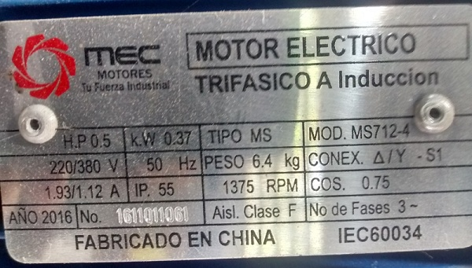
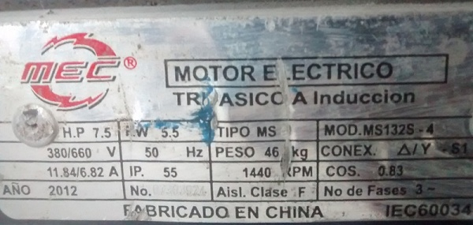
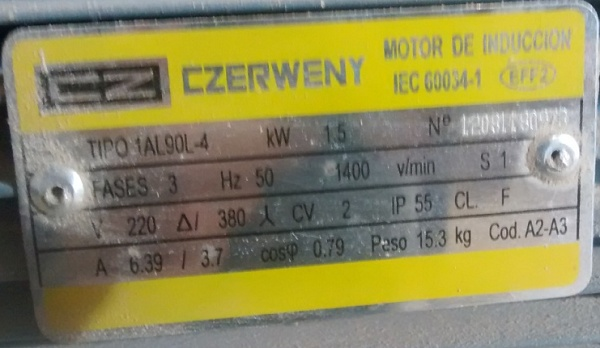

<!-- *** GUIDE START *** -->

La lectura de la placa de características de un motor trifásico es clave para conectarlo sin dañarlo. Un punto es no sobrepasar la tensión máxima que soporta el aislamiento del bobinado individual. Esta tensión dependerá de si lo conecto en estrella o triángulo.

Tener en cuenta que: **Las tensiones de placa son siempre DE LÍNEA (entre fases)** ya que los motores trifásicos no usan el cable neutro de la red; solo se conectan a las 3 fases ($R, S, T$) y a la tierra de protección. Por esto no entran en juego ni interesan las tensiones de fase (entre fase y neutro).

::: note
Cuando el motor se conecta en estrella uniendo las tres bobinas en el centro de la estrella se genera un punto común llamado **centro de estrella** o **neutro artificial**.

* En un motor, las 3 bobinas son idénticas y la carga está perfectamente equilibrada.
* Por la suma vectorial de las tres fases (desfasadas $120^\circ$), la suma de las corrientes en ese punto central es **cero** ($I_R + I_S + I_T = 0$).
* Al no haber corriente circulando hacia afuera de ese punto, **no hace falta ningún cable de neutro de la red**.
* La tensión entre la fase y ese punto central pasa a ser automáticamente $380\text{ V} / \sqrt{3} \approx 220\text{ V}$ por física del sistema
:::

Los formatos de la placa puede variar ligeramente pero normalmente muestra **dos tensiones** y el tipo de conexión para uno y otro caso.

**Ejemplo 1:**

::: example

::: figure
{width=400px}

<small>Motor de una máquina que hace bloques de hormigón</small>
:::

La placa indica que si la tensión de línea (entre fase y fase) es:

- 220 V se conecta en triángulo
- 380 V se conecta en estrella

**Conexión:** Como en Argentina la tensión de línea es 380V se conecta en estrella

:::

::: note
La conexión en triángulo me indica de modo directo la tensión máxima que soporta cada bobina, en este caso 220V. En una conexión en estrella la tensión que llega a cada bobinado ya no es la tensión de línea directa, sino que es $U_L / \sqrt{3}$ y como aquí $U_L=380V$ cada bobinado recibe $380 / \sqrt{3}\approx 220\text{ V}$, que es justo para lo que fue diseñada.
:::

**Ejemplo 2:**

::: example

::: figure
{width=400px}

<small>Motor de una máquina que hace mezcla de hormigón</small>
:::

La placa indica que si la tensión de línea (entre fase y fase) es:

- 380 V se conecta en triángulo
- 660 V se conecta en estrella

**Conexión:** Como en Argentina la tensión de línea es 380V se conecta en triángulo

:::

**Ejemplo 3:**

::: example

::: figure
{width=400px}

<small>Motor de una sierra sin fin para cortar madera</small>
:::

La placa indica que si la tensión de línea (entre fase y fase) es:

- 220 V se conecta en triángulo
- 380 V se conecta en estrella

**Conexión:** Como en Argentina la tensión de línea es 380V se conecta en estrella

:::

<!-- *** GUIDE END *** -->

<!-- *** GUIDE AUXILIARY THINGS *** -->

<!--

● Sections: example, activity. solutions, figure, warning, note

::: example
### Ejemplo: Cálculo de derivadas
Aquí va el contenido de tu ejemplo. Puedes usar Markdown normal adentro.
:::

● Image:

::: figure
{width=400px}

<small>Pie (Source)</small>
:::

[⌕](../../images/ ) 

● Videos:

 Change XXX to video-id and put time in seconds

 - Yotube with start point: [Mira este momento clave en el video](https://www.youtube.com/watch?v=XXX&t=123s)

 - Youtubetrimmer with start and end point: [Mirá este momento puntual del video](https://youtubetrimmer.com/view/?v=XXX&start=120&end=150&loop=0)

-->
