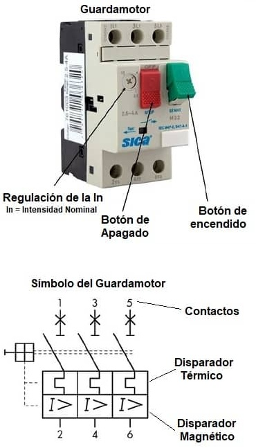

<!-- *** GUIDE START *** -->

## 1. Selección del dispositivo de protección

Con la $I_B$ e $I_Z$ obtenidas en la etapa anterior ahora toca seleccionar las protecciones específicas contra sobrecargas y cortocircuitos. 

El típico pequeño interruptor automático (PIA), conocido popularmente como térmica o termomagnética, tiene dos mecanismos de disparo: uno térmico, que actúa ante sobrecargas prolongadas, y otro magnético, que responde rápidamente ante cortocircuitos. Sin embargo, por sí solo no suele brindar una protección adecuada contra las sobrecargas de un motor eléctrico.

El guardamotor es un interruptor automático diseñado específicamente para proteger y maniobrar motores eléctricos. Permite regular la protección térmica según la corriente nominal indicada en la placa del motor y dispone de un disparador magnético que tolera los elevados picos de corriente propios del arranque. Según el modelo, también puede ofrecer protección ante la falta de fase, evitando daños en el motor.

::: figure
{width=350px}
:::

### Actividad

::: activity
Buscar y seleccionar un guardamotor (con su hoja de datos) cuyo rango de corrientes permita regularlo a la corriente nominal del motor que calculaste en la etapa anterior. Por ejemplo si la corriente nominal del motor es 15,3 A el rango de corrientes del guardamotor podría ser 13-18 A.

::: warning
Cuando se instala el guardamotor este se regula lo más exactamente posible a la corriente nominal del motor.
:::

:::

## 2. Verificación contra sobrecargas

Consiste en comprobar analíticamente que el guardamotor seleccionado desconectará el circuito ante un exceso de corriente sostenido antes de que el calentamiento dañe la aislación de los conductores, las conexiones o el entorno.

::: figure
{width=550px}

<small>Coordinación de corrientes (Figura 771.19.A)</small>
:::

### A. Las Dos Condiciones Normativas de Coordinación

Según la subcláusula **771.19.2.1** y la **Figura 771.19.A**, la característica de funcionamiento de la protección contra sobrecargas debe satisfacer simultáneamente dos inecuaciones reglamentarias:

#### Primera condición

Servicio normal sin disparos en falso: **$I_B \le I_n \le I_Z$**

donde:

* ($I_B$) Corriente de proyecto
* ($I_r$) Corriente asignada / Regulada de la protección. Es la intensidad a la que se ajusta la perilla del guardamotor.
* ($I_Z$) Corriente admisible del conductor. Es la capacidad máxima de corriente que puede transportar el cable en régimen permanente según el tipo de canalización y los factores de corrección por temperatura y agrupamiento.

Obsevaciones importantes:

* Este criterio apunta a proteger el cable, de modo que se interrumpa la corriente antes de llegar a la corriente máxima admisible del cable $I_Z$. 
* Para dispositivos con disparo ajustable, como el guardamotor, la norma establece que la corriente nominal $(I_n)$ se reemplaza por el valor de regulación elegido ($I_r$), resultando $I_B \le I_r \le I_Z$.
* Pero como el propósito del guardamotor es proteger el motor (antes que el cable) se regula su corriente ajustable $I_r$ a la corriente nominal del motor. Si lo ajustara a una corriente mayor no protegería bien el motor. Por esto la inecuación queda: $I_r \le I_B \le I_Z$. Y esto resulta incluso más beneficioso para el cable por que el interruptor cortará, salvo en el arranque, en un valor probablemente más bajo incluso que la $I_B$.

#### Segunda condición

Garantía de disparo térmico seguro: **$I_2 \le 1,45 \cdot I_Z$**

**($I_2$):** Es la corriente mínima que el fabricante nos garantiza que hará saltar la protección sí o sí si se sostiene presente durante el tiempo estipulado por la norma (1 hora). 

* Los guardamotores se hacen bajo las normas IEC 60947-4-1 / IEC 60947-2 y la primera estipula que la corriente convencional de disparo térmico en 1 hora ($I_2$) se calcula multiplicando el valor ajustado en la perilla ($I_r$) por un coeficiente normado:$I_2 = 1,30 \cdot I_r$
* La reglamentación AEA 90364-7-771 ratifica este coeficiente en la subcláusula 771.19.3 e) para interruptores automáticos e industriales de calibre hasta 63 A bajo norma IEC 60947).

En este [anexo](05-project4-anexo.html) se explica esta inecuación más a fondo.

### Actividad

::: activity

**a)** Si elegiste un guardamotor cuya perilla se pueda ajustar a la corriente nominal del motor la primera condición se cumple sin más. Para verificar la segunda condición calculas $I_2$ según lo explicado y luego verificas la desigualdad.

**b)** Prepara una breve explicación sobre el porqué de la segunda inecuación 

:::

## 3. Corrientes máxima y mínima de cortocircuito

::: note
Como aclaración, cuando la norma habla de **"Aguas Arriba"** se refiere a todo lo ubicado en dirección hacia la fuente de energía (el transformador de la red pública o la distribuidora). Y cuando habla de **"Aguas abajo"** se refiere a todo lo ubicado en dirección hacia las cargas (los tableros secundarios, cables y el motor de la cinta transportadora).
:::

### A. Corriente de cortocircuito máxima ($I"_{k \text{ max}}$)

#### En el tablero principal

Es la corriente que aparece cuando el cortocircuito sucede en los bornes de salida de este tablero. Este lazo involucra los conductores que hay desde el tablero principal hasta el transformador incluyendo su bobinado secundario. Aquí la corriente alcanza su máximo valor destructivo por que los cables son gruesos y ofrecen poca resistencia.  

Se considera que es la corriente máxima de falla que la red eléctrica externa (la distribuidora) puede inyectar en la entrada del edificio.

La norma pide que se pregunte el valor de esta corriente a la empresa distribuidora. Pero cuando se trata de proyectos educativos o la empresa no mandó el documento con este valor se pueden usar valores orientativos. 

**Valores orientativos:**

* *1)* Si la instalación está conectada a la red pública urbana estándar, donde el tablero principal puede estar quizás a decenas o cientos de metros del transformador de la calle, y tomando valores típicos de la red urbana, es razonable tomar entre **3000 A (3 kA)** a **5000 A (5 kA)**.
* *2)* Si la industria cuenta con un transformador propio o se está al lado del transformador de la calle, este valor puede superar fácilmente los **10.000 A (10 kA)** debido a la baja resistencia de la red cercana. En el caso de un transformador propio se pueden usar los valores de la tabla 771-H.II.

#### En un tablero secundario

Este es nuestro caso por que el motor tiene su propio tablero donde está el guardamotor. Además este tablero está a una cierta distancia del tablero principal. El guardamotor no está sometido al cortocircuito bruto de la entrada sino que está sometido a un valor atenuado por la distancia que lo separa del tablero principal.

La norma apoya este razonamiento en la cláusula 771.19.2.2.2 que indica que la capacidad de ruptura del dispositivo de protección, será por lo menos igual a la máxima intensidad de corriente de cortocircuito presunta $I"_{k \text{ max}}$ en el punto donde el dispositivo está instalado.

**Cálculo analítico:**

- Fórmula exacta: $I"_{k\text{ max}} = \frac{c \cdot U_{fase}}{Z_{\text{lazo total}}} = \frac{c \cdot U_{fase}}{Z_{\text{fuente/red}} + Z_{cable}}$ donde c es un factor que considera la caída de tensión al momento de la falla y es de 0,95 a 1. Las "Z" son las impedancias.
- Fórmula simplificada considerando c=1 y que los cables entre el transformador de la calle y el tablero principal son gruesos y su resistencia es muy baja: $I"_{k\text{ max}} = \frac{U_{fase}}{Z_{\text{cable}}}$  HACER la cuenta en clase para explicar por que Zfuente/red es despreciable, sería 220V/(3000 o 5000A), el cortocircuito bruto)
- Resistencia del cable: $Z_{\text{cable}} = \frac{\rho \cdot (2 \cdot L)}{S}$ donde:
   + $\rho$ es la resistividad del cobre en **frío**, aprox. 0.018 $\frac{\Omega \cdot mm^2}{m}$
   + L: longitud del cable multiplicada por 2 (ida y vuelta)
   + S: sección del cable en mm2

### B. Corriente de cortocircuito mínima ($I_{k\text{ min}}$)

Es la corriente que aparece cuando el cortcircuito sucede en el punto más alejado de la línea (en los bornes del motor más lejano). Toda la resistencia del cobre del cable reduce la corriente a su valor más bajo.

Sirve para verificar el **Umbral de Disparo Magnético ($I_{\text{mag}}$) de la protección.

La norma facilita tablas para su determinación pero también puede usarse un cálculo analítico.

**Nuestro caso:** Las tablas de la norma arranca de cables de sección mayor a 2.5 mm2. Por esto la calculamos por cálculo analítico.

**Cálculo analítico:** Es similar al anterior pero tomando el valor de la resistividad del cobre en caliente (80 - 90 °C). Es un poco mayor que la otra y permite calcular una corriente lo más baja posible, una condición más exigente a cumplir. En este caso: 

- Fórmula exacta: $I_{k\text{ min}} = \frac{c \cdot U_{fase}}{Z_{\text{lazo total}}} = \frac{c \cdot U_{fase}}{Z_{\text{fuente/red}} + Z_{cable}}$ donde el $Z{cable}$ abarca los dos tramos, desde el tablero principal al tablero del motor y de éste a la falla al final de la línea.
- Fórmula simplificada: $I_{k\text{ min}} = \frac{U_{fase}}{Z_{\text{cable}}}$
- Resistencia del cable: $Z_{\text{cable}} = \frac{\rho \cdot (2 \cdot L)}{S}$ donde:
   + $\rho$ es la resistividad del cobre en caliente (80-90°C), aprox. 0.0225 $\frac{\Omega \cdot mm^2}{m}$
   + L: longitud del cable multiplicada por 2 (ida y vuelta)
   + S: sección del cable en mm2

**Verificación:** La corriente que activa el "gatillo" de la protección ($I_{mag}$) debe ser estar por debajo de esta corriente mínima, es decir: $I_{\text{mag}} < I_{k\text{ mín}}$. Esto asegura que, aunque la falla sea más "débil" por la distancia, el aparato la reconozca como un cortocircuito y desconecte el circuito en menos de **0,1 segundos** antes de que el cable se queme.

### Actividad

::: activity

**a)** Determinar las corrientes de cortocircuito máxima y mínima para el guardamotor.

**b)** Verificar usando la hoja de datos del guardamotor que la capacidad de corte en el rango de tensión del motor, usualmente denominada ($I_{cu}$), sea mayor que $I"_{k \text{ max}}$

**c)** Verificar usando la hoja de datos del guardamotor que el parámetro "Intensidad de disparo magnético" (o Magnetic tripping current / Corriente de disparo instantáneo) sea menor a $I_{k\text{ min}}$. Esto significa que la menor corriente de falla posible en la punta de la línea debe ser mayor que la corriente necesaria para accionar el gatillo magnético del guardamotor.

:::

::: warning
Para aprobar esta etapa se presenta en papel esta parte de la memoria descriptiva, ordenada y prolijo. Se explica además oralmente lo escrito.
:::

<!-- *** GUIDE END *** -->

<!-- *** GUIDE AUXILIARY THINGS *** -->

<!--

● Sections: example, activity. solutions, figure, warning, note

::: example
### Ejemplo: Cálculo de derivadas
Aquí va el contenido de tu ejemplo. Puedes usar Markdown normal adentro.
:::

● Image:

::: figure
{width=400px}

<small>Pie (Source)</small>
:::

[⌕](../../images/ ) 

● Videos:

 Change XXX to video-id and put time in seconds

 - Yotube with start point: [Mira este momento clave en el video](https://www.youtube.com/watch?v=XXX&t=123s)

 - Youtubetrimmer with start and end point: [Mirá este momento puntual del video](https://youtubetrimmer.com/view/?v=XXX&start=120&end=150&loop=0)

-->
