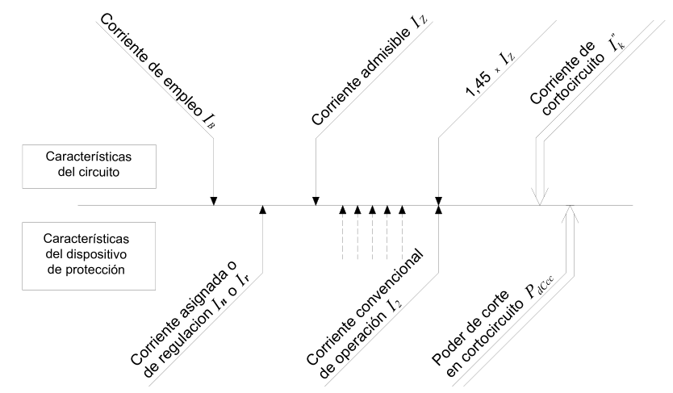

<!-- *** GUIDE START *** -->

## 1. Corrientes máxima y mínima de cortocircuito

En la norma se habla de "Aguas Arriba" y "Aguas Abajo", aclaremos esta terminología:

* **Aguas arriba (Upstream):** Todo lo ubicado en dirección hacia la fuente de energía (el transformador de la red pública o la distribuidora).
* **Aguas abajo (Downstream):** Todo lo ubicado en dirección hacia las cargas (los tableros secundarios, cables y el motor de la cinta transportadora).

### A. Corriente de cortocircuito máxima ($I"_{k \text{ max}}$)

Es la corriente que aparece cuando el cortocircuito sucede en los bornes de salida del tablero principal de la industria. Este lazo involucra los conductores que hay desde el tablero principal hasta el transformador incluyendo su bobinado secundario. Aquí la corriente alcanza su máximo valor destructivo por que los cables son gruesos y ofrcen poca resistencia.  

Se considera que es la corriente máxima de falla que la red eléctrica externa (la distribuidora) puede inyectar en la entrada del edificio.

La norma pide que se pregunte el valor de esta corriente a la empresa distribuidora. 

**Nuestro caso:** Siendo un ejercicio didáctico y basado en valores de referencia que usa la norma en las tablas se pueden tomar los siguientes valores orientativos:

* *1)* Si la instalación está conectada a la red pública urbana estándar, la norma orienta valores probables de **3000 A (3 kA)** a **5000 A (5 kA)**.
* *2)* Si la industria cuenta con un transformador propio o se está al lado de una subestación, este valor puede superar fácilmente los **10.000 A (10 kA)** debido a la baja resistencia de la red cercana. En el caso de un transformador propio se pueden usar los valores de la tabla 771-H.II.

**Verificación:** El dispositivo de protección debe tener un poder de corte igual o mayor a esta corriente máxima ($I_{cu} \ge I"_{k\text{ máx}}$) para poder apagar el arco eléctrico sin explotar ni dañarse.

### B. Corriente de cortocircuito mínima ($I_{k\text{ min}}$)

Es la corriente que aparece cuando el cortcircuito sucede en el punto más alejado de la línea (en los bornes del motor más lejano). Toda la resistencia del cobre del cable reduce la corriente a su valor más bajo.

Sirve para verificar el **Umbral de Disparo Magnético ($(I_{\text{mag}}$) de la protección.

La norma facilita tablas para su determinación pero también puede usarse un cálculo analítico.

**Nuestro caso:** Las tablas de la norma arranca de cables de sección mayor a 2.5 mm2 y las longitudes son algo chicas. Por esto la calculamos por cálculo analítico.

**Cálculo analítico:**

- Fórmula exacta: $I_{k\text{ min}} = \frac{c \cdot U_{fase}}{Z_{\text{lazo total}}} = \frac{c \cdot U_{fase}}{Z_{\text{fuente/red}} \cdot Z_{cable}}$ donde c es un factor que considera la caída de tensión al momento de la falla y es de 0,95 a 1. Las "Z" son las impedancias.
- Fórmula aproximada con c=1: $I_{k\text{ min}}$ = \frac{U_{fase}}{Z_{\text{cable}}$
- Resistencia del cable: $Z_{\text{cable}} = \frac{\rho \cdot (2 \cdot L)}{S}$ donde:
   + $\rho$ es la resistividad del cobre en caliente, aprox. 0.0225 $fracc{\Omega \cdot mm^2}{m}$
   + L: longitud del cable multiplicada por 2 (ida y vuelta)
   + S: sección del cable en mm2

**Verificación:** El "gatillo" instantáneo de la protección debe ajustarse por debajo de esta corriente mínima ($I_{\text{mag}} < I_{k\text{ mín}}$). Esto asegura que, aunque la falla sea más "débil" por la distancia, el aparato la reconozca como un cortocircuito y desconecte el circuito en menos de **0,1 segundos** antes de que el cable se queme.

### Actividad

::: activity

Determinar las corrientes de cortocircuito máxima y mínima explicando las decisiones que se toman.

:::

## 2. Verificación contra sobrecargas

Consiste en comprobar analíticamente que el dispositivo de protección seleccionado (guardamotor o interruptor automático) desconectará el circuito ante un exceso de corriente sostenido antes de que el calentamiento dañe la aislación de los conductores, las conexiones o el entorno.

::: figure
{width=500px}

<small>Coordinación de corrientes (Figura 771.19.A)</small>
:::

### A. Las Dos Condiciones Normativas de Coordinación

Según la subcláusula **771.19.2.1** y la **Figura 771.19.A**, la característica de funcionamiento de la protección contra sobrecargas debe satisfacer simultáneamente dos inecuaciones reglamentarias:

*1).* **Primera condición (Servicio normal sin disparos en falso):** $I_B \le I_n \le I_Z$
   *(Para dispositivos con disparo ajustable, como los guardamotores, la norma establece que la corriente nominal $(I_n)$ se reemplaza por el valor de regulación elegido ($I_r$), resultando $I_B \le I_r \le I_Z$.*

*2).* **Segunda condición (Garantía de disparo térmico seguro):** $I_2 \le 1,45 \cdot I_Z$

donde:

* ($I_B$) Corriente de proyecto
* ($I_r$) Corriente asignada / Regulada de la protección. Es la intensidad a la que se ajusta la perilla del guardamotor.
* ($I_Z$) Corriente admisible del conductor. Es la capacidad máxima de corriente que puede transportar el cable en régimen permanente según el tipo de canalización y los factores de corrección por temperatura y agrupamiento.
* ($I_2$) Corriente convencional de funcionamiento u operación. Es la intensidad de corriente que asegura el disparo del dispositivo de protección en un tiempo convencional adecuado. Para pequeños interruptores automáticos (PIA) de hasta 63 A bajo norma IEC 60898, la corriente convencional de disparo es $I_2 = 1,45 \cdot I_n$. Para guardamotores o relés térmicos industriales (IEC 60947-4-1), ($I_2$) está definido por el fabricante (usualmente entre $(1,20 \cdot I_r)$ y $(1,25 \cdot I_r)$.

### Actividad

::: activity

Según la norma basta con poner un guardamotor y un protector diferencial, ahora vas a seleccinarlos.

**a)** La norma exige que se proteja al motor con un guardamotor ya que en estos se pueden setear su In a un valor adecuado para el motor, para protegerlo de sobretensiones más o menos continuas. Elegir un guardamotor que cumpla las condiciones de cortocircuito y verifique contra sobrecargas.

**b)** Elegir un protector diferencial adecuado. 

:::

::: warning
Para aprobar esta etapa se presenta en papel esta parte de la memoria descriptiva, ordenada y prolijo. Se explica además oralmente lo escrito.
:::

<!-- *** GUIDE END *** -->

<!-- *** GUIDE AUXILIARY THINGS *** -->

<!--

● Sections: example, activity. solutions, figure, warning, note

::: example
### Ejemplo: Cálculo de derivadas
Aquí va el contenido de tu ejemplo. Puedes usar Markdown normal adentro.
:::

● Image:

::: figure
{width=400px}

<small>Pie (Source)</small>
:::

[⌕](../../images/ ) 

● Videos:

 Change XXX to video-id and put time in seconds

 - Yotube with start point: [Mira este momento clave en el video](https://www.youtube.com/watch?v=XXX&t=123s)

 - Youtubetrimmer with start and end point: [Mirá este momento puntual del video](https://youtubetrimmer.com/view/?v=XXX&start=120&end=150&loop=0)

-->
