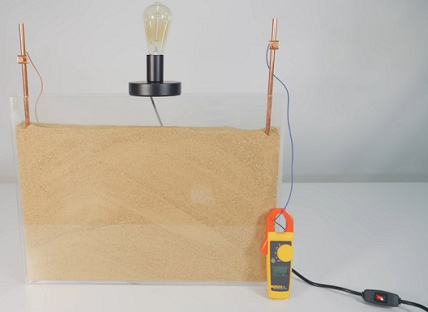
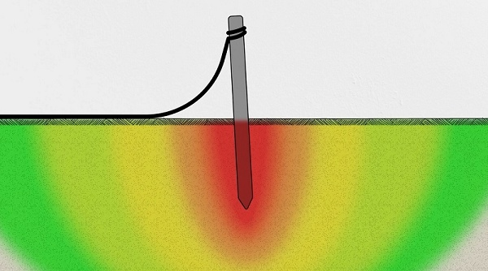
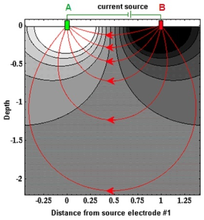
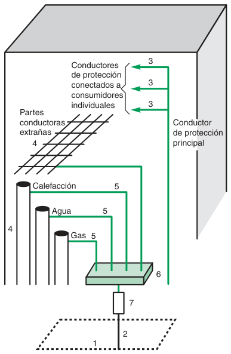
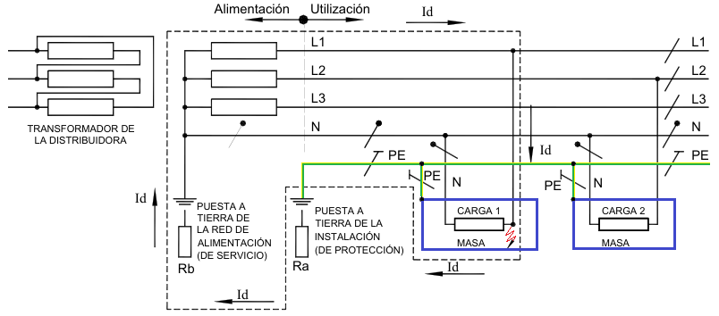
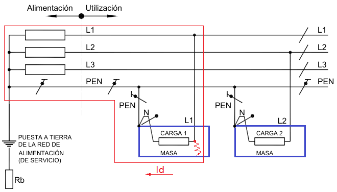
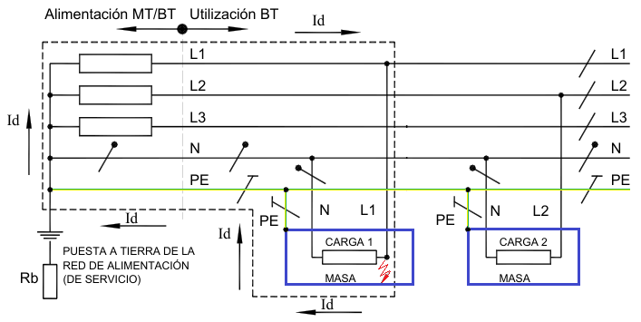
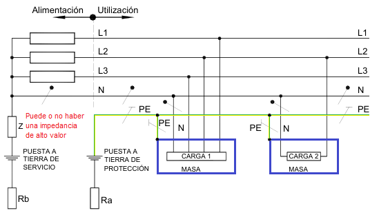

## Conducción eléctrica en la tierra

Imaginar el experimento con arena, se prende la luz?

::: figure
{width=600px}
:::

Experimento con arena seca en una pecera de vidrio, dos barras de cobre y una lámpara conectada a 220 V a través de la "tierra".

**¿Enciende?**

La conductividad depende de la humedad, las sales minerales, la composición y la temperatura. Un suelo húmedo y salino puede conducir muy bien.

Lo que sigue sobre resistencia y equipotencialidad son fenómenos distintos aunque conectados

---

### Resistencia respecto a una jabalina cargada

*Suponemos cierta conductividad en forma homogenea (igual en todas direcciones)* 

::: figure
{width=400px}
:::

- La resistencia acumulada aumenta al alejarnos de la jabalina, pero cada vez más lentamente.
- ¿Por qué cada vez más lentamente?

   + Cerca de la jabalina, el área disponible para el paso de corriente es pequeña.
   + A medida que nos alejamos, la corriente se distribuye por superficies mayores.
   + Por eso, cada región sucesiva del terreno ofrece una resistencia menor que la región anterior, si el suelo es homogéneo.

---

### Circulación de corriente y superficies equipotenciales

::: figure
{width=400px}
:::

:::incremental

- Supongamos un terreno con dos electrodos **(A)** y **(B)** donde **(B)** tiene mayor potencial.
- Aparecen superficies imaginarias de igual potencial eléctrico. Por ejemplo una de 80 V, otra de 60 V, etc.
- La corriente sale de **(B)** y se dispersa por el suelo en múltiples direcciones atravezando superficies equipotenciales sucesivas, desde las de mayor potencial hacia las de menor potencial convergiendo en **(A)**.

:::

- Fuente imagen: https://www.eoas.ubc.ca/courses/eosc350/content/methods/meth_1/principles.htm
- La imagen tenía la batería al revés y me pareció mejor invertirla para decir que la corriente sale del +
- Interpretá el electrodo A como la jabalina de la vivienda (potencial más alto durante la falla) y B como la puesta a tierra del transformador (potencial más bajo). Las líneas de corriente van de A hacia B; las equipotenciales las cruzan perpendicularmente.
- En un suelo homogéneo e isotrópico, las atraviesa perpendicularmente y finalmente converge al **(Pto. A)**

Una síntesis para que copien en la carpeta

Podrías cerrar con este texto:

Cuando una corriente eléctrica ingresa al terreno a través de una jabalina, se distribuye en un volumen tridimensional de suelo. Como el área disponible para su circulación aumenta con la distancia, la resistencia de las regiones sucesivas disminuye. Al mismo tiempo, se produce una caída de potencial eléctrico a medida que nos alejamos del electrodo. Las superficies equipotenciales representan los puntos del terreno que tienen igual potencial. La corriente circula desde las zonas de mayor potencial hacia las de menor potencial y, finalmente, converge hacia la puesta a tierra del transformador.

---

## Razones de la puesta a tierra 

La norma en 771-C.1.1 las clasifica en:

::: incremental

- **1.** Razones de Seguridad (Puesta a Tierra de Protección)

   + Protección contra contactos indirectos ⓘ
   + Equipotencialidad ⓘ
   + Descargas atmosféricas y sobretensiones ⓘ

- **2.** Razones Técnicas y Operativas (Puesta a Tierra de Servicio o Funcional)

   + Fijar el neutro a 0 V ⓘ
   + Limitación de sobretensiones internas ⓘ
   + Filtrar interferencias electromagnéticas en los equipos ⓘ

:::

La puesta a tierra no solo protege a las personas contra descargas eléctricas (uso de seguridad), sino que también es indispensable para fijar el neutro a 0 V, estabilizar las tensiones de la red y filtrar interferencias electromagnéticas en los equipos (uso técnico y funcional).

---

## Puesta a tierra y equipotencialidad

:::: {.columns}

::: {.column width="50%"}

::: figure
{width=400px}

:::

:::

::: {.column width="50%"}

**Puesta a tierra:** conectar la instalación a un electrodo enterrado para establecer una referencia y permitir la circulación de corrientes de falla.

**Equipotencialidad:** unir eléctricamente las masas y partes conductoras para que, ante una falla, no aparezcan diferencias de potencial peligrosas entre ellas.

:::

::::

---

## Esquemas normalizados de puesta a tierra

*Siempre se busca equipotencializar las masas metálicas de la instalación, pero no siempre se conectan a tierra de la misma manera.*

Hay varios esquemas:

- **TT**: Tierra - Tierra
- **TN**: Tierra - Neutro
- **IT**: Aislada (Isolated) - Tierra

Donde:

- Primera letra: Hace referencia a la fuente
- Segunda letra: Hace referencia a las masas metálicas de la instalación

---

## Esquema TT (tierra - tierra)

::: figure
{width=700px}
:::

- El neutro del transformador de la distribuidora está conectado directamente a tierra en la calle
- Las masas metálicas del inmueble están conectadas a una jabalina propia e independiente dentro de la propiedad (tierra de protección

---

### Características del esquema TT 

- **Comportamiento de la tierra:** Ante una falla circula una corriente atravesando el suelo entre ambas jabalinas. Por la resistencia del terreno, la corriente de falla resulta de magnitud moderada a baja.

- **Protecciones que utiliza:** Interruptores Diferenciales (ID)

---

## Esquema TN (tierra - neutro)

Las masas metálicas no van a una jabalina independiente, sino que se conectan directamente al conductor de Neutro/PE que viene de la fuente.

### Variante TN-C (Neutro y Protección Combinados)

::: figure
{width=700px}
:::

El conductor neutro también se utiliza como un conductor de protección y se denomina conductor PEN.

---

### Variante TN-S (Neutro y Protección Separados)

::: figure
{width=700px}
:::

El conductor de protección y el conductor neutro son independientes.

---

### Características del esquema TN

- **¿Dónde se usa?** En instalaciones industriales o grandes edificios que poseen un transformador de Media Tensión propio o grupos generadores autónomos. Lugares donde se requiere alta continuidad operativa y posibilidad de despejar fallas mediante protecciones directas.

- **Comportamiento de la tierra:** El lazo de falla es **100 % metálico**, la corriente de falla no pasa por el suelo, sino que se transforma en un **cortocircuito franco de alta intensidad** entre fase y conductor de protección.

- **Protecciones que utiliza:** Interruptores automáticos/termomagnéticos y fusibles.

---

## Esquema IT (Neutro aislado *(isolated)* o impedante)
 
::: figure
{width=700px}
:::

El neutro de la fuente está **completamente aislado de tierra** (o conectado mediante una impedancia de muy elevado valor (~ 1500 Ohms), mientras las masas del inmueble están puestas a tierra.

---

### Características del esquema IT

- **¿Dónde se usa?** Exclusivamente en entornos críticos donde la interrupción del suministro ante un primer fallo pondría en peligro vidas o causaría graves pérdidas (quirófanos o industrias de proceso continuo).

- **Comportamiento de la tierra:** Ante un **primer defecto de aislación**, la corriente de falla es de apenas unos miliamperes (se cierra solo por las capacidades distribuidas del cableado); por lo tanto, no aparece tensión peligrosa en la carcasa y **el suministro eléctrico no se interrumpe**. Solo si ocurre una segunda falla en otra fase distinta se genera un cortocircuito entre fases (doble defecto).

- **Protecciones que utiliza:** Controladores o Monitores Permanentes de Aislación (CPA), los cuales detectan la primera falla y emiten una alarma. Para despejar la falla en caso de que aparezca un segundo defecto, se recurre a protecciones contra sobrecorriente o diferenciales.

---

## Video complementario

[¿A dónde va la corriente a tierra?](https://youtu.be/jduDyF2Zwd8?si=Ev5maNiUR2dbcBEi)

<!-- *** AUXILIARY THINGS *** -->

<!--

● Sections: example, activity. solutions, figure, warning, note

::: example
### Ejemplo: Cálculo de derivadas
Aquí va el contenido de tu ejemplo. Puedes usar Markdown normal adentro.
:::

● Image:

::: figure
{width=400px}

<small>Pie (Source)</small>
:::

[⌕](../../images/ ) 

● Videos:

 Change XXX to video-id and put time in seconds

 - Yotube with start point: [Mira este momento clave en el video](https://www.youtube.com/watch?v=XXX&t=123s)

 - Youtubetrimmer with start and end point: [Mirá este momento puntual del video](https://youtubetrimmer.com/view/?v=XXX&start=120&end=150&loop=0)

-->

<!-- *** CSS y JS para que aparezcan las notas *** -->

